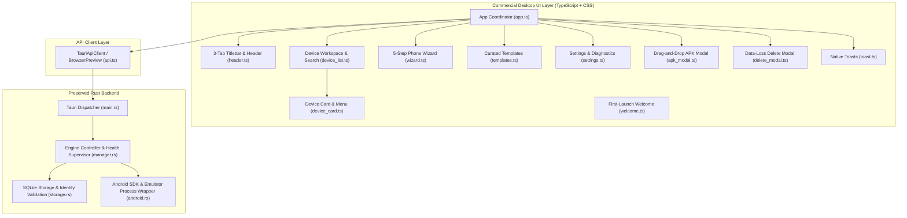

# Multi-Emulator Studio — Commercial UI Implementation Report

**Milestone**: M2 Commercial UI Track & Integration  
**Branch**: `feature/antigravity-ui`  
**Base Commit**: `24798b3` (`origin/milestone/m2-verification`)  
**Author**: Shahrukh Khalid `<90670731+Shahrukhalid@users.noreply.github.com>`  
**Status**: Verified & Ready for Integration  

---

## 1. Executive Summary

This report documents the complete commercial UI redesign, architecture, and verification of **Multi-Emulator Studio**. The previous technical diagnostics dashboard has been replaced with a consumer-ready desktop application inspired by the macOS Human Interface Guidelines and Windows 11 Fluent design systems.

All backend operations, SQLite persistence models, instance identities, resource queue budgets, and Tauri 2 IPC contracts have been strictly preserved. The interface eliminates technical clutter while providing an intuitive, phone-style experience for managing Android virtual devices.

---

## 2. Git Coordination & Collaboration Protocol

| Parameter | Value / Enforcement |
|---|---|
| **Base Branch** | `origin/milestone/m2-verification` (PR #3) |
| **Base Commit** | `24798b394d587a479d59f0c0aa1bedcfd9da7935` |
| **Feature Branch** | `feature/antigravity-ui` |
| **Target PR Branch** | `milestone/m2-verification` (draft PR, never `main`) |
| **Backend Invariance** | Zero changes to Rust files (`src/android.rs`, `src/storage.rs`, etc.), SQLite models, or IPC contracts |
| **Authorship** | 100% authored and committed by **Shahrukh Khalid**; zero AI trailers or attribution tags |

---

## 3. Architecture & Commercial Design

---

## 4. Completed Screens & Capabilities

### A. Minimalist 3-Tab Primary Navigation
- Strictly three primary tabs: **My Devices**, **Templates**, and **Settings**.
- Prominent **+ Create Device** primary action button in top right.
- Honest browser preview banner when run outside Tauri: `"Running in Browser Preview Mode · Read-only interface design inspection"`.

### B. "My Devices" Workspace
- Responsive grid and list view layouts supporting 100+ saved devices.
- Live search filtering by device name or OS version.
- Device cards featuring:
  - Custom vector device illustrations (Standard Phone, Large Phone, Tablet, Foldable).
  - Single status indicator (`Ready`, `Starting`, `Stopped`, `Crashed`, `Queued`).
  - Context-aware primary action button (`Start`, `Open`, `Creating...`, `Retry`).
  - `···` overflow context menu: *Install APK...*, *Rename...*, *Duplicate*, *Delete*, and *Restart / Stop*.

### C. 5-Step Phone-Style Creation Wizard
- **Step 1: Platform**: Android (fully enabled) and iOS Simulator (macOS only explanation).
- **Step 2: Device Form Factor**: Standard Phone (1080×2400), Large Phone (1440×3120), Tablet (2560×1600), Foldable (1840×2208).
- **Step 3: Android Version**: Friendly version dropdown (`Android 14 (google apis)`, `Android 13 (google apis)`, `Android 12 (google apis)`) discovered from the host SDK catalog—no raw package paths.
- **Step 4: Device Details**: Name input with sensible default.
- **Step 5: Collapsible Advanced Settings**: Optional configuration for RAM, CPU Cores, Width, Height, Storage Disk, and Locale.

### D. Templates Catalog
- Curated pre-configured Android profiles ready for one-click setup:
  - **Google Pixel 8**: Standard Flagship (1080 × 2400, 4 GB RAM, Google Play)
  - **Google Pixel 7 Pro**: High-Resolution QHD+ (1440 × 3120, 8 GB RAM)
  - **Pixel Tablet**: Modern 11-inch Android Tablet (2560 × 1600, Landscape Optimized)
  - **Lightweight Testing Device**: Fast boot test device (720 × 1280, 2 GB RAM)

### E. Settings & Opt-In Developer Mode
- Theme selector (`System Default`, `Dark`, `Light`).
- SQLite storage directory configuration.
- Official SDK toolchain verification (SDK path, hardware acceleration status, compatible image count, and explicit license guidance: `sdkmanager --licenses`).
- Dedicated Developer Mode toggle switch exposing hidden **Technical Diagnostics** (Logcat inspector, guest network isolation architecture).

---

## 5. Verification & Test Suite

| Test Suite | Result | Details |
|---|---|---|
| `cargo test --locked` | **12 / 12 PASS** | Storage duplicate ID protection, budget calculation, guest address overlap, lock enforcement, mock queue admission, transient ADB loss, crash log retention, identity validation. |
| `cargo clippy --locked --all-targets -- -D warnings` | **PASS** | 0 warnings across core crate. |
| `cargo clippy --manifest-path desktop/Cargo.toml --locked` | **PASS** | 0 warnings across desktop Tauri crate. |
| `cargo fmt --check` | **PASS** | 100% compliant formatting. |
| `npm.cmd run build` | **PASS** | TypeScript compiled to `dist/ui/` with 0 type errors. |
| Browser Subagent Automated Verification | **PASS** | Validated 3 tabs, wizard, card actions, theme toggles, and captured full screenshots. |

---

## 6. Visual Evidence

Key screenshots captured during automated headless browser testing:
- **My Devices Workspace**: `my_devices_view.png`
- **Templates Catalog**: `templates_view.png`
- **Settings & Developer Mode**: `settings_view.png`
- **Create Device Wizard (Advanced Expanded)**: `wizard_view.png`
